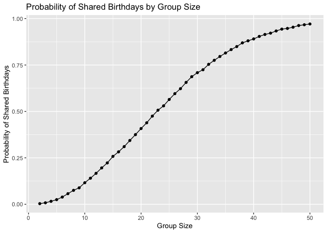
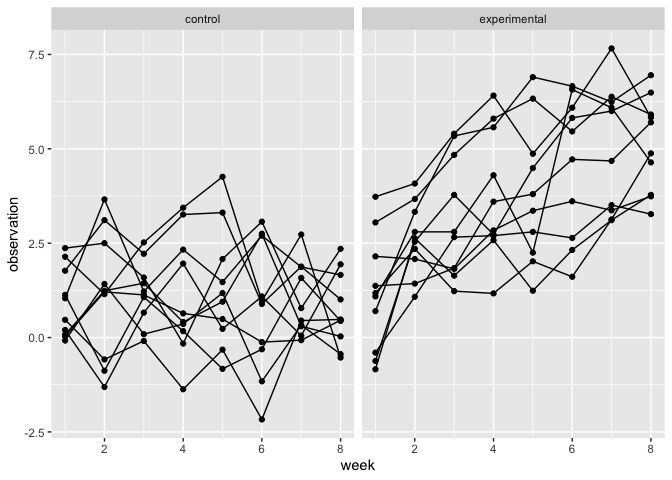
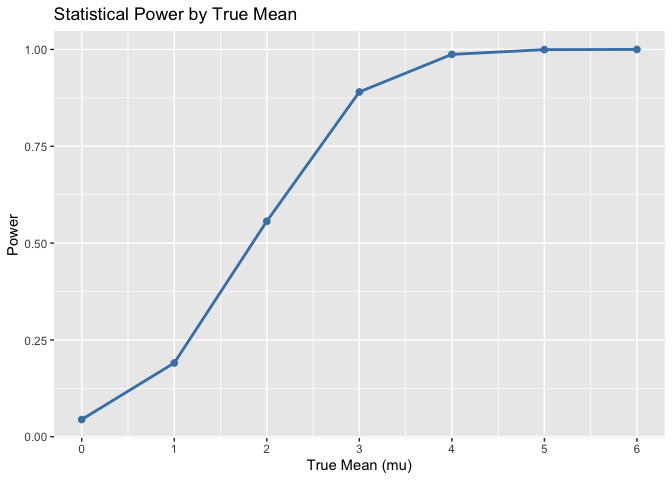
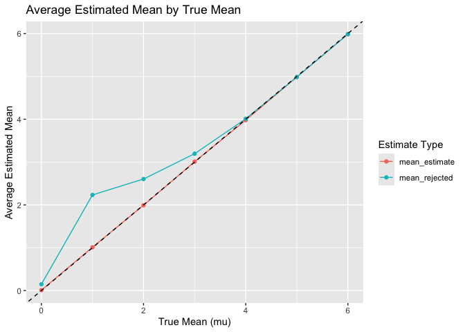

p8105_hw5_yp2846
================

``` r
library(tidyverse)
```

    ## ── Attaching core tidyverse packages ──────────────────────── tidyverse 2.0.0 ──
    ## ✔ dplyr     1.2.1     ✔ readr     2.2.0
    ## ✔ forcats   1.0.1     ✔ stringr   1.6.0
    ## ✔ ggplot2   4.0.3     ✔ tibble    3.3.1
    ## ✔ lubridate 1.9.5     ✔ tidyr     1.3.2
    ## ✔ purrr     1.2.2     
    ## ── Conflicts ────────────────────────────────────────── tidyverse_conflicts() ──
    ## ✖ dplyr::filter() masks stats::filter()
    ## ✖ dplyr::lag()    masks stats::lag()
    ## ℹ Use the conflicted package (<http://conflicted.r-lib.org/>) to force all conflicts to become errors

# Problem 1

``` r
set.seed(123)

birthday_sim = function(n) {
  birthdays = sample(1:365, size = n, replace = TRUE)
  any(duplicated(birthdays))
}

birthday_results =
  expand_grid(
    group_size = 2:50,
    iter = 1:10000
  ) |>
  mutate(
    shared_birthday = map_lgl(group_size, birthday_sim)
  ) |>
  group_by(group_size) |>
  summarize(
    probability = mean(shared_birthday),
    .groups = "drop"
  )
```

``` r
birthday_results |>
  ggplot(aes(x = group_size, y = probability)) +
  geom_line() +
  geom_point() +
  labs(
    title = "Probability of Shared Birthdays by Group Size",
    x = "Group Size",
    y = "Probability of Shared Birthdays"
  )
```

<!-- -->

The probability of at least two people sharing a birthday increases as
the group size increases. The probability reaches approximately 50% with
23 people and increases to about 97% with 50 people. Although there are
365 possible birthdays, the probability increases quickly because the
number of possible pairs grows as more people are added to the group.

## Problem 2

``` r
longitudinal_files =
  tibble(
    files = list.files("data/"),
    path = str_c("data/", files)
  ) |>
  mutate(
      data = map(path, ~read_csv(.x, show_col_types = FALSE))
  ) |> 
  unnest(cols = c(data))

longitudinal_data =
  longitudinal_files |>
  mutate(
    arm = if_else(
      str_detect(files, "^con_"),
      "control",
      "experimental"
    ),
    subject_id = str_extract(
      files,
      "\\d+"
    )
  ) |>
  pivot_longer(
    cols = starts_with("week_"),
    names_to = "week",
    values_to = "observation"
  ) |>
  mutate(
    week = as.numeric(str_remove(week, "week_"))
  )|>
  select(
    subject_id, arm, week, observation
  )
```

``` r
longitudinal_data |>
  ggplot(aes(x = week, y = observation,group = interaction(arm, subject_id))) +
  geom_point() +
  geom_line()+
  facet_grid(. ~ arm)
```

<!-- -->

The spaghetti plot shows different trends between the two groups.
Observations in the control group fluctuate over the eight weeks without
a clear increasing or decreasing trend, with most values between -2 and
4. In contrast, the experimental group shows a general upward trend,
with observations reaching approximately 3 to 8 by week 8. Although
individual trajectories vary, the difference between the two groups
becomes larger over time, suggesting a possible positive treatment
effect.

## Problem 3

``` r
set.seed(123)

sim_t_test = function(mu) {
  sim_data = rnorm(n = 30, mean = mu, sd = 5)

  t.test(sim_data, mu = 0) |>
    broom::tidy() |>
    select(estimate, p.value)
}
```

``` r
sim_results =
  expand_grid(
    mu = 0:6,
    iter = 1:5000
  ) |>
  mutate(
    results = map(mu, sim_t_test)
  ) |>
  unnest(cols = c(results)) |>
  mutate(
    reject = p.value < 0.05
  )

power_results =
  sim_results |>
  group_by(mu) |>
  summarize(
    power = mean(reject),
    .groups = "drop"
  )
```

``` r
power_results |>
  ggplot(aes(x = mu, y = power)) +
  geom_line(color = "steelblue", linewidth = 1) +
  geom_point(color = "steelblue", size = 2) +
  scale_x_continuous(breaks = 0:6) +
  labs(
    title = "Statistical Power by True Mean",
    x = "True Mean (mu)",
    y = "Power"
  )
```

<!-- -->

The probability of rejecting the null hypothesis increases as the true
mean increases. When the true mean is 0, the rejection proportion is
approximately 0.05, consistent with the significance level. Power
increases from about 0.19 at a true mean of 1 to about 0.89 at a true
mean of 3, and approaches 1 when the true mean reaches 4. This suggests
that larger effect sizes are more likely to be detected when the sample
size and standard deviation remain fixed.

``` r
estimate_results =
  sim_results |>
  group_by(mu) |>
  summarize(
    mean_estimate = mean(estimate),
    mean_rejected = mean(estimate[reject]),
    .groups = "drop"
  )
```

``` r
estimate_results |>
  pivot_longer(
    cols = c(mean_estimate, mean_rejected),
    names_to = "estimate_type",
    values_to = "average_estimate"
  ) |>
  ggplot(
    aes(
      x = mu,
      y = average_estimate,
      color = estimate_type
    )
  ) +
  geom_line() +
  geom_point() +
  geom_abline(
  slope = 1,
  intercept = 0,
  linetype = "dashed"
) +
  labs(
    title = "Average Estimated Mean by True Mean",
    x = "True Mean (mu)",
    y = "Average Estimated Mean",
    color = "Estimate Type"
  )
```

<!-- -->

The average estimated mean across all simulations is very close to the
true mean, as shown by the red line overlapping with the dashed
reference line. However, the average estimate among rejected tests is
higher than the true mean when the true mean is small. For example, when
the true mean is 1, the average estimate among rejected tests is
approximately 2.2.

This difference occurs because samples with larger estimated effects are
more likely to produce statistically significant results. When the true
mean is small, selecting only rejected tests tends to overestimate the
true effect. As the true mean increases, power approaches 1, and the
average estimate among rejected tests becomes closer to the true mean.

When the true mean is 0, significant estimates can be either positive or
negative, so their average remains close to zero. Overall, the results
show that selecting only statistically significant tests can introduce
bias, especially when power is low.
